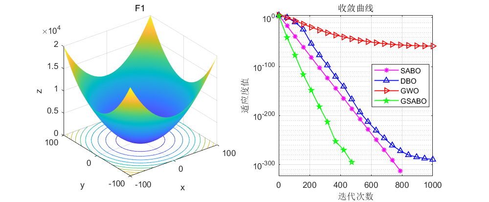
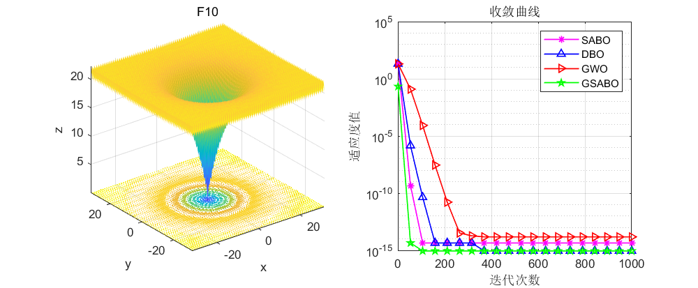
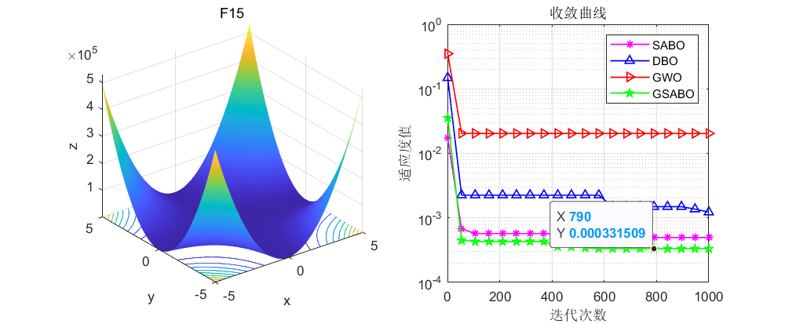
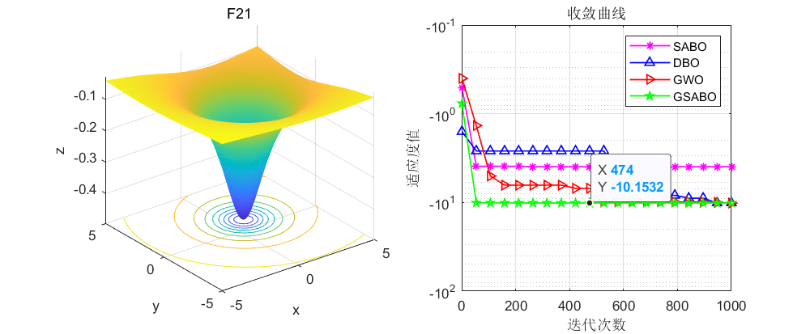
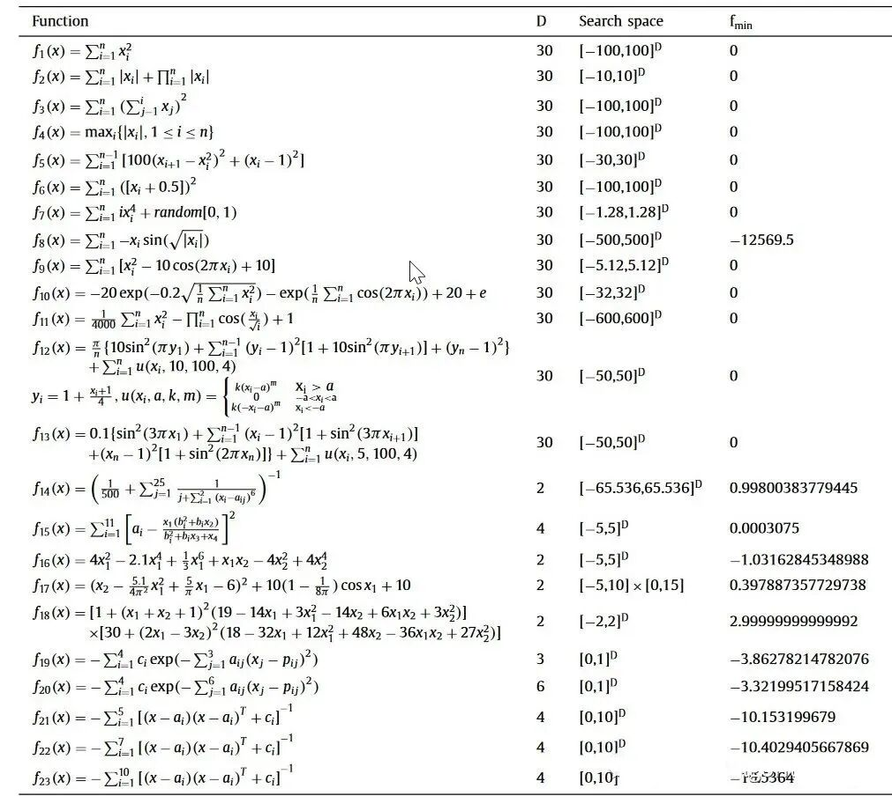
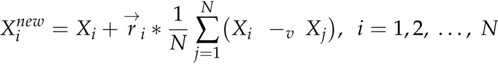

# Integrate Golden Sine and Ten Chaos Maps, done! Achieve the optimal value every time. This approach can be applied to the improvement of all intelligent algorithms.

The previous article on the latest optimization algorithm for 2023, the Subtraction Optimizer (SABO), has already shown quite good results. Moreover, due to its very simple formula principle, it is particularly suitable for beginners who are just starting to explore intelligent optimization algorithms.
Today's article brings you a new approach: the Gold-Sine Augmented Subtraction Optimizer (GSABO). This article will explain the improvement ideas, providing a universal and feasible approach for future improvements in intelligent algorithms. This idea can also be applied to other intelligent optimization algorithms.
Let's take a look at some results first, to see the effect. SABO is the Subtraction Optimizer algorithm itself that we want to improve; DBO is the Dung Beetle Optimization Algorithm, which has excellent search optimization performance; GWO is the Grey Wolf Algorithm, which is also widely used. The GSABO algorithm is the Gold-Sine Augmented Subtraction Optimizer, which is the main subject of this article.
Those who frequently use intelligent algorithms should know that the F5 and F8 functions from the CEC2005 function test set pose significant challenges to intelligent algorithms. Among them, the theoretical minimum value of the F5 function is 0, and the improved GSABO algorithm's search optimization value is 6.19*e-06, while the grey wolf algorithm (GWO), Dung Beetle optimization algorithm (DBO), and subtraction optimizer (SABO) all have values around 27, which is also the bottleneck for most intelligent algorithms and the reason why most bloggers dare not show such a comparison chart.
Looking at the F8 function, since it has multiple peaks, intelligent algorithms easily fall into local optima during its search optimization process, making it challenging for intelligent optimization algorithms. Its theoretical minimum value is -12569.5. Generally, intelligent optimization algorithms perform well only up to -7000, but the Gold-Sine Augmented Subtraction Optimizer proposed in this article achieves a search optimization value of -12569.4737 for the F8 function, which is very close to the theoretical value and has a very fast convergence speed!
Here are the formulas and corresponding extrema of the CEC2005 function.
Improvement Principle
Here is a brief explanation of the principles behind the improvements, with more detailed explanations available in the program's comments.
The improvement approach for this article is as follows:
1. Initialization of particles using ten types of chaos mapping methods
Using these methods can make particles diverse, accelerating the convergence of the algorithm. For the method of improving intelligent algorithms through ten types of chaos mapping, you can refer to this article for a more detailed explanation. Optimizing the Grey Wolf Algorithm with ten types of chaos mapping, which can be switched on-the-fly, can be used to optimize all population-based intelligent algorithms, and an introduction is provided using the Grey Wolf Algorithm as an example.
2. Generating random values to replace the ri value using piecewise mapping
In the original SABO algorithm, the ri value is a random value. When replacing the ri value with random values generated by the piecewise mapping, the algorithm itself becomes more evenly distributed due to the random values, helping the algorithm increase particle diversity during average difference calculations. If you encounter any algorithms that have random values in the future, you might want to try this method.
3. Using the golden sine method to help particles escape from local optima
Due to the SABO algorithm not utilizing the global optimal value at each iteration but rather using the average of all particle positions to update, it is very easy for particles to get stuck in local optima when initializing their positions poorly, as evidenced by functions F5 and F8.
Therefore, the improvement approach in this article is: if the fitness value of the particles does not change during the current iteration, then use the golden sine algorithm to update the particle positions. This not only does not excessively increase the computational load for fitness value updates but also utilizes the advantage of the golden sine algorithm in global optimization to help the SABO algorithm escape from local optima. This method can also be referenced for other algorithms, which will yield surprising results. Several details will be marked in the code. Next, we will present the main function code.

## Images

<!-- PAYMENT_BLOCK -->

## Get this dataset

- Payment link (Stripe): [Buy now](https://buy.stripe.com/3cs8yP7sY87d0vu9AB)
- Payment QR code: 

<!-- /PAYMENT_BLOCK -->
